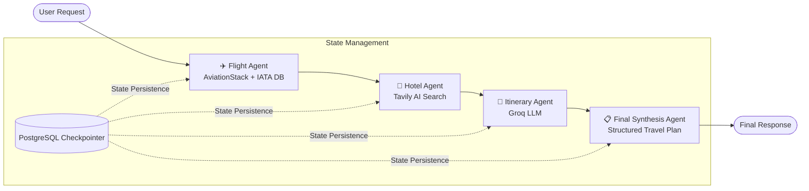

# ✈️ TripMate — Autonomous Multi-Agent AI Travel Planner

TripMate is an intelligent, multi-agent travel planning system built on **LangGraph**, **Groq**, and **FastAPI**. It coordinates specialized AI agents to discover real flights, recommend curated hotels, create day-by-day itineraries, and synthesize personalized, budget-conscious travel plans—with conversational memory persisted in **PostgreSQL**.

---

## 🌟 Key Features

- **Multi-Agent Orchestration**: Modular workflow managed with LangGraph StateGraph, coordinating specialized sub-agents.
- **Ultra-Fast LLM Inference**: Powered by Groq (`openai/gpt-oss-20b` / configurable models).
- **Live Flight Search**: Automated destination & IATA airport extraction with real-time flight lookups via AviationStack, `airportsdata`, and `pycountry`.
- **Intelligent Hotel Discovery**: Real-time web search for top accommodations, ratings, and locations using Tavily AI Search.
- **Stateful Memory & Checkpointing**: Threaded multi-turn conversational persistence powered by `PostgresSaver`.
- **FastAPI Web Application**: Clean, responsive web UI with real-time chat, structured outputs, and a RESTful API.
- **Docker & Cloud Ready**: Production-optimized `Dockerfile` with multi-provider port handling (Render, Railway, Cloud Run).

---

## 🏗️ Architecture & Workflow

The application executes as a directed graph where state flows sequentially through specialized agents before returning a formatted travel proposal:



### Agent Roles:
1. **Flight Agent (`flight_agent`)**: Parses origin and destination from user queries, maps country/city names to IATA codes, and queries the AviationStack flight API.
2. **Hotel Agent (`hotel_agent`)**: Executes tailored Tavily web queries to find top-rated hotels, amenities, and location advantages.
3. **Itinerary Agent (`itinerary_agent`)**: Synthesizes flight and hotel data into a cohesive, realistic daily travel schedule.
4. **Final Response Agent (`final_agent`)**: Formats the entire package into structured sections (Trip Summary, Flight Info, Hotel Suggestions, Daily Itinerary, Estimated Budget, and Practical Recommendations).

---

## 📁 Project Structure

```
TripMate/
├── app.py                  # FastAPI server, web routes, and REST endpoints
├── backend.py              # LangGraph definition, agent nodes, and Postgres saver
├── Dockerfile              # Containerization definition
├── .dockerignore           # Build context exclusions
├── requirements.txt        # Python package dependencies
├── test.py                 # CLI script for testing agent flow directly
├── tools/
│   ├── flight_tool.py      # AviationStack integration & IATA airport resolver
│   └── tavily_tool.py      # Tavily search tool for accommodations
├── static/
│   ├── script.js           # Client-side UI logic and API communication
│   └── style.css           # Modern stylesheet for chat UI
└── templates/
    └── index.html          # Chat interface template (Jinja2)
```

---

## ⚙️ Environment Variables

Create a `.env` file in the project root with the following keys:

| Variable | Description | Required | Default |
|---|---|:---:|---|
| `GROQ_API_KEY` | API key from [Groq Console](https://console.groq.com) | Yes | — |
| `GROQ_MODEL` | Groq model identifier | No | `openai/gpt-oss-20b` |
| `TAVILY_API_KEY` | Search API key from [Tavily](https://tavily.com) | Yes | — |
| `AVIATIONSTACK_API_KEY` | Flight API key from [AviationStack](https://aviationstack.com) | Yes | — |
| `DEFAULT_ORIGIN_IATA` | Default departure country/airport code if unspecified | No | `USA` |
| `DATABASE_URL` | PostgreSQL connection string for LangGraph checkpointing | Yes | — |
| `LANGSMITH_TRACING` | Set to `"true"` to enable LangSmith tracing | No | `false` |
| `LANGSMITH_API_KEY` | LangSmith API key for debugging and observability | No | — |
| `LANGSMITH_PROJECT` | Project name for LangSmith tracing | No | `TripMate` |

---

## 🚀 Getting Started

### 1. Prerequisites
- Python 3.11+
- PostgreSQL database instance (Render, Supabase, Neon, or local PostgreSQL)
- API Keys: Groq, Tavily, and AviationStack

### 2. Installation

```bash
# Clone repository
git clone https://github.com/your-username/TripMate.git
cd TripMate

# Create and activate virtual environment
python3 -m venv venv
source venv/bin/activate    # On Windows: venv\Scripts\activate

# Install dependencies
pip install --upgrade pip
pip install -r requirements.txt
```

### 3. Setup Configuration
Copy your environment variables into `.env`:
```bash
cp .env.example .env   # Or create .env manually with required keys
```

### 4. Run the Application

#### Option A: FastAPI Web App
```bash
python app.py
# or
uvicorn app:app --host 127.0.0.1 --port 8000 --reload
```
Open your browser at **`http://127.0.0.1:8000`** to access the web interface.

#### Option B: Terminal CLI Test
```bash
python test.py
```

---

## 🔌 API Reference

### Health Check
```http
GET /health
```
**Response:**
```json
{
  "status": "ok",
  "message": "AI Travel Planner API is running"
}
```

### Travel Planning Request
```http
POST /api/travel
Content-Type: application/json
```

**Request Body:**
```json
{
  "message": "Plan a 5-day trip to Tokyo from New York with a moderate budget",
  "thread_id": "optional-session-id"
}
```

**Response Body:**
```json
{
  "success": true,
  "thread_id": "user_a1b2c3d4",
  "answer": "### Trip Summary\n...",
  "flight_results": "...",
  "hotel_results": "...",
  "itinerary": "...",
  "llm_calls": 4
}
```

---

## 🐳 Docker Deployment

### Build the Image
```bash
docker build -t tripmate .
```

### Run the Container
```bash
docker run -d \
  -p 8000:8000 \
  --env-file .env \
  --name tripmate-app \
  tripmate
```

The container automatically reads the `$PORT` environment variable if deployed on managed platforms like Render, Railway, or Google Cloud Run.

---

## 🛡️ License

This project is licensed under the MIT License.
